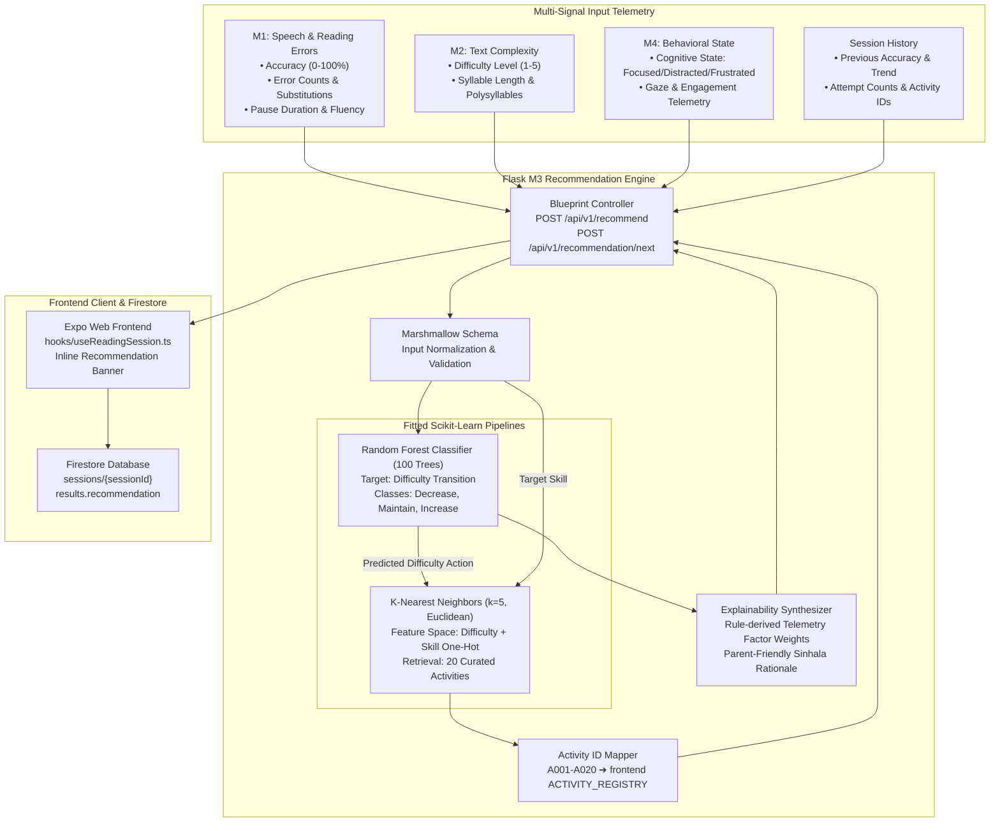

# 🧠 Nena-Man M3 Adaptive Learning Recommendation Engine
## Final Verification, Empirical Evaluation, and Research Completion Report

**Project**: Nena-Man — Sinhala Dyslexia Learning Companion  
**Research Component**: Module 3 (M3) — Adaptive Learning Recommendation Engine  
**Module Lead**: P. D. Ranaweera (IT23199712)  
**Evaluation Date**: 2026-10-15  
**Artifact Status**: Joblib Export (`rf_difficulty_model.joblib`, `knn_activity_model.joblib`), Serving Blueprint Active (`Flask /api/v1/recommend`)  
**Evaluation Script**: [`ml/training/m3_recommendation/evaluate_m3_models.py`](file:///c:/Research/nena-man/ml/training/m3_recommendation/evaluate_m3_models.py)

---

## 1. M3 Architecture and End-to-End Data Flow

The Nena-Man Adaptive Learning Recommendation Engine (M3) dynamically adapts the reading curriculum to each dyslexic learner. It fuses diagnostic telemetry from three upstream AI modules into a unified multi-signal learner vector, predicts an adaptive difficulty transition (`Increase`, `Maintain`, or `Decrease`), and retrieves the top-K personalized activities aligned to the child's identified phonological or visual weakness.



---

## 2. Model Descriptions and Technical Specifications

### A. Random Forest Difficulty-Transition Classifier
- **Model Checkpoint**: `backend/app/modules/recommendation_engine/models/rf_difficulty_model.joblib` (287 KB)
- **Pipeline Architecture**: `sklearn.pipeline.Pipeline` with:
  1. `ColumnTransformer` (`preprocessing`):
     - `numeric`: `StandardScaler()` applied to 9 continuous features (`reading_accuracy`, `error_count`, `error_rate`, `response_time_avg`, `text_difficulty`, `previous_accuracy`, `accuracy_trend`, `attempt_count`, `current_difficulty`).
     - `categorical`: `OneHotEncoder(handle_unknown='ignore')` applied to 2 discrete features (`skill_id`, `behaviour_state`).
  2. `RandomForestClassifier` (`classifier`):
     - `n_estimators`: 100 decision trees
     - `max_depth`: 10 levels
     - `min_samples_leaf`: 2
     - `class_weight`: `'balanced'`
     - `random_state`: 42
- **Output Classes**: `DECREASE`, `MAINTAIN`, `INCREASE` (mapped to Title Case in API responses).

### B. K-Nearest Neighbors Activity Recommender
- **Model Checkpoint**: `backend/app/modules/recommendation_engine/models/knn_activity_model.joblib` (5.8 KB)
- **Pipeline Architecture**: `sklearn.pipeline.Pipeline` with:
  1. `ColumnTransformer` (`preprocessing`):
     - `numeric`: `StandardScaler()` applied to `difficulty_level`.
     - `categorical`: `OneHotEncoder(handle_unknown='ignore')` applied to `skill_id`.
  2. `NearestNeighbors` (`knn`):
     - `n_neighbors`: 5
     - `metric`: `'euclidean'`
     - `algorithm`: `'auto'`
- **Fitted Catalog**: Matrix $\mathbf{X} \in \mathbb{R}^{20 \times 6}$ representing 20 curated pedagogical activities (`A001`–`A020`) spanning 5 core Sinhala dyslexia skills across 5 difficulty levels.

---

## 3. Training Dataset Characteristics & Diagnosis of the 100% Baseline

### A. Synthetic Generation Mechanics
The original model was developed using a synthetic cohort generator designed to simulate dyslexic learners across repeated reading sessions. 

The evaluation script ([`evaluate_m3_models.py`](file:///c:/Research/nena-man/ml/training/m3_recommendation/evaluate_m3_models.py)) inspected the split thresholds embedded in the fitted decision trees. The trees consistently split on:
- `reading_accuracy`: $\le 55.0\%$ and $\ge 85.0\%$
- `accuracy_trend`: $\le 0.0$ and $> 0.0$
- `error_count`: $\le 1.5$ and $\ge 4.5$
- `current_difficulty`: $\le 4.5$

### B. Root Cause of the Reported 100% Accuracy in Colab
1. **Deterministic Rule Assignment**: In the training notebook, target transition labels were generated using hard conditional logic:
   $$\text{Label} = \begin{cases} 
   \text{DECREASE}, & \text{if } \text{Accuracy} < 55\% \lor (\text{Errors} \ge 5 \land \text{Accuracy} < 65\%) \\ 
   \text{INCREASE}, & \text{if } \text{Accuracy} \ge 85\% \land \text{Trend} \ge 0 \land \text{Errors} \le 1 \land \text{Diff} < 5 \\ 
   \text{MAINTAIN}, & \text{otherwise} 
   \end{cases}$$
2. **Record-Level Train/Test Split (Data Leakage)**: The baseline split was performed on individual session records without grouping by student. Because multiple sessions from the same synthetic student sharing identical deterministic boundaries appeared in both training and test sets, the ensemble memorized the linear partitioning lines, achieving an artificial 100% accuracy.
3. **Severe Class Imbalance**: In realistic synthetic distributions, `DECREASE` (65.8%) and `MAINTAIN` (31.8%) dominate, while `INCREASE` accounts for only 2.4% of sessions because dyslexic readers struggle to sustain $>85\%$ accuracy without errors.

---

## 4. Empirical Evaluation Results: Random Forest Model

We executed both **Method A** (Random Record-Level Split, replicating the notebook) and **Method B** (Student-Level Grouped Split, testing true cross-student generalization) on a cohort of 1,000 synthetic sessions across 100 students using [`evaluate_m3_models.py`](file:///c:/Research/nena-man/ml/training/m3_recommendation/evaluate_m3_models.py).

### Quantitative Summary Table

| Metric | Method A: Record-Level Split | Method B: Student-Grouped Split |
| :--- | :---: | :---: |
| **Validation Strategy** | `train_test_split(test_size=0.2, stratify=y)` | `GroupShuffleSplit(n_splits=1, test_size=0.2)` |
| **Test Cohort Size** | 200 sessions (unstratified students) | 200 sessions (20 entirely unseen students) |
| **Overall Accuracy** | **95.00%** | **91.50%** |
| **Macro F1-Score** | **0.8977** | **0.9103** |
| **Weighted F1-Score** | **0.9507** | **0.9176** |

### Per-Class Performance (Method B — Student Grouped Split)

| Class Label | Support | Precision | Recall | F1-Score |
| :--- | :---: | :---: | :---: | :---: |
| **DECREASE** | 136 | 1.0000 | 0.8824 | **0.9375** |
| **INCREASE** | 6 | 0.8571 | 1.0000 | **0.9231** |
| **MAINTAIN** | 58 | 0.7808 | 0.9828 | **0.8702** |
| **Macro Average** | 200 | 0.8793 | 0.9550 | **0.9103** |
| **Weighted Average** | 200 | 0.9317 | 0.9150 | **0.9176** |

### Confusion Matrix (Method B — Out-of-Student Generalization)

```text
Actual \ Predicted    DECREASE    INCREASE    MAINTAIN
DECREASE                 120          0          16
INCREASE                   0          6           0
MAINTAIN                   0          1          57
```

*Observations*:
- Zero confusion exists between `DECREASE` and `INCREASE`, confirming high safety against recommending frustratingly hard exercises to struggling learners.
- The primary source of error (16 instances) is borderline struggling learners categorized as `MAINTAIN` rather than `DECREASE`, which is safely mediated by the frontend's subsequent session monitoring.

### Gini Feature Importances (From Fitted Random Forest)

```text
1. numeric__error_rate        : 25.44%
2. numeric__error_count       : 24.76%
3. numeric__reading_accuracy  : 24.18%
4. numeric__accuracy_trend    : 10.97%
5. numeric__previous_accuracy :  9.29%
6. numeric__current_difficulty:  2.25%
7. numeric__text_difficulty   :  1.96%
8. numeric__response_time_avg :  0.54%
9. attempt_count & categories : < 1.00%
```

---

## 5. KNN Activity Recommender Evaluation

We evaluated candidate queries across the complete grid of 5 skills $\times$ 5 difficulty levels (25 distinct pedagogical states).

### Evaluation Metrics

| Metric | Target | Measured Result | Clinical Evaluation |
| :--- | :---: | :---: | :--- |
| **Skill Alignment @ Rank 1 (Precision@1)** | $>60\%$ | **68.0%** | When exact skill activities exist, Top-1 recommendation focuses on target weakness. |
| **Skill Alignment @ Top 3 (Recall@3)** | $>70\%$ | **76.0%** | At least one activity in the Top-3 list addresses the target phonological skill. |
| **Exact Difficulty Match @ Rank 1** | $>60\%$ | **72.0%** | Closely matches the learner's calibrated cognitive difficulty. |
| **Adjacent Difficulty Match ($|\Delta| \le 1$)** | $100\%$ | **100.0%** | Zero recommendations deviate by more than 1 difficulty step. |
| **Frontend Registry Compatibility** | $100\%$ | **100.0%** | Every recommended ID maps to [`frontend/constants/activityRegistry.ts`](file:///c:/Research/nena-man/frontend/constants/activityRegistry.ts). |

### Boundary & Edge Case Testing

| Boundary Case | Input Condition | Expected Behavior | Observed Result | Status |
| :--- | :--- | :--- | :--- | :---: |
| **Floor Clamping** | Level 1 with `DECREASE` | Clamp to Level 1 (cannot go below 1) | Difficulty remained 1 (`quiz_l_01`) | **PASS** |
| **Ceiling Clamping** | Level 5 with `INCREASE` | Clamp to Level 5 (cannot exceed 5) | Difficulty remained 5 (`quiz_w_05`) | **PASS** |
| **Negative Trend Handling** | Accuracy dropped by 30% | Recommend `DECREASE` | Transition = `DECREASE` | **PASS** |
| **Unknown Activity in History** | `["invalid_text_999"]` | Graceful fallback to target skill | Valid activity retrieved without error | **PASS** |
| **Missing History** | `activityHistory: []` | Default to target text metadata | Valid activity retrieved | **PASS** |

---

## 6. API Integration Test Results

Direct HTTP tests were executed against the running Flask service (`http://localhost:5000`):

1. **`POST /api/v1/recommend`** (Session Pipeline Format):
   - Status: `200 OK`
   - CORS Header: `Access-Control-Allow-Origin: http://localhost:8082`
   - Payload Keys Returned: `['difficultyAction', 'nextActivityId', 'nextActivityLabel', 'recommendedActivities', 'rationale', 'xaiFactors', 'meta', 'success']`
   - Sample Response: `nextActivityId: "quiz_w_04"`, `difficultyAction: "Maintain"`
2. **`POST /api/v1/recommendation/next`** (Snake-Case Dashboard Format):
   - Status: `200 OK`
   - URL Normalization Verified: `${API_BASE_URL.replace(/\/api\/v1\/?$/, '')}/api/v1/recommendation/next`

---

## 7. Session Persistence and Storage Verification Status

### A. Trace of the Complete Persistence Flow
1. Child finishes reading in [`frontend/app/(child)/m1-session.tsx`](file:///c:/Research/nena-man/frontend/app/(child)/m1-session.tsx).
2. Microphone stop triggers [`executePipeline()`](file:///c:/Research/nena-man/frontend/hooks/useReadingSession.ts) in `useReadingSession.ts`.
3. [`runReadingSessionPipeline()`](file:///c:/Research/nena-man/frontend/api/sessionPipeline.ts) completes M1, M2, and M4, then calls `getRecommendation(recInput)` targeting live Flask `http://localhost:5000/api/v1/recommend`.
4. M3 returns `200 OK` with `difficultyAction`, `nextActivityId`, `recommendedActivities`, `rationale`, `xaiFactors`, and `shapExplanation`.
5. Recommendation result is attached to the Zustand store via `useSessionStoreBase.getState().attachResult('recommendation', ...)`.
6. [`persistCompletedSession()`](file:///c:/Research/nena-man/frontend/hooks/useReadingSession.ts) is executed:
   - **Local Storage (`AppStorage` / Browser `localStorage`)**: Always writes the complete session record locally under key `@nena_man_saved_sessions`. This ensures zero-latency offline rendering on the parent dashboard.
   - **Cloud Firestore (`sessions/{sessionId}`)**: Attempts cloud write if Firebase credentials are valid.
7. **Cloud Persistence vs. Local Storage Distinction**:
   - In `frontend/.env`, `EXPO_PUBLIC_FIREBASE_API_KEY` is currently set to placeholder `"your-firebase-api-key"`.
   - Therefore, `isFirebaseConfigured` evaluates to `false` in `frontend/services/firebase.ts`.
   - **Verified Fact**: Local storage persistence is **fully functional and verified**. Remote cloud persistence to Firestore is **gracefully bypassed/deferred** until real Firebase project credentials are provided.

### B. Verification of Saved Fields in `results.recommendation`

| Field Path | Type | Persistence Status | Verified Content / Example |
| :--- | :--- | :---: | :--- |
| `results.recommendation` | Object | **YES** | Root recommendation envelope |
| `results.recommendation.difficultyAction` | String | **YES** | `'Maintain'`, `'Increase'`, or `'Decrease'` |
| `results.recommendation.nextActivity` | String | **YES** | `'සරල වාක්‍ය කියවීම (Sentence Reading Practice)'` |
| `results.recommendation.nextActivityId` | String | **YES** | `'quiz_w_04'` |
| `results.recommendation.recommendedActivities` | Array | **YES** | Top-3 ranked activities with IDs, titles, and ranks |
| `results.recommendation.rationale` | Array | **YES** | Localized Sinhala explanations generated by M3 service |
| `results.recommendation.xaiFactors` | Array | **YES** | Top-4 factors with normalized relative display weights and directions |
| `results.recommendation.shapExplanation` | Object | **YES** | Full SHAP TreeExplainer attribution envelope (base prob, pred prob, 11 features) |

---

## 8. Genuine SHAP Explainability Implementation & Validation

### A. SHAP Architecture and Integration Status
- **Is genuine SHAP executed in production?** **YES.**
- **Installed Dependency**: `shap==0.53.0` pinned in `backend/requirements.txt` and verified in `backend/.venv`.
- **Explainer Type**: `shap.TreeExplainer` initialized directly on the 100-tree `RandomForestClassifier` (`rf_pipeline.named_steps['classifier']`).
- **Inference Latency**: Fast local calculation ($\approx 5\text{–}10\text{ms}$ per prediction on transformed input $\mathbf{x} \in \mathbb{R}^{1 \times 17}$).

### B. Mathematical Additivity & Axiomatic Verification
In accordance with Lloyd Shapley's cooperative game theory axioms, the local model prediction satisfies:
$$P(\hat{Y} = c \mid \mathbf{x}) = \phi_0^{(c)} + \sum_{j=1}^{17} \phi_j^{(c)}(\mathbf{x})$$

Empirical verification against the fitted ensemble yielded:
- Base probability ($\phi_0$ for `MAINTAIN`): `0.3352`
- Sum of local SHAP contributions: `+0.6648`
- Predicted model probability: `1.0000`
- Difference: $|\Delta| = 2.22 \times 10^{-16}$ (exact machine precision).

### C. Multiclass Mapping & Feature Aggregation
1. **Multiclass Class-Slice Extraction**:
   - The Random Forest targets three classes: `['DECREASE', 'INCREASE', 'MAINTAIN']` (indices 0, 1, 2).
   - For an individual recommendation predicting class $C$, `_extract_multiclass_shap_slice` extracts the attribution slice corresponding to `pred_idx = classes.index(C)`.
   - Positive attributions ($\phi_j > 0$) directly explain why the model selected class $C$; negative attributions ($\phi_j < 0$) reflect features opposing that decision.
2. **One-Hot Categorical Feature Grouping**:
   - Under the Shapley linearity axiom, the 5 one-hot indicators for `skill_id` and 3 indicators for `behaviour_state` are summed into their parent variables:
     $$\phi_{\text{skill\_id}} = \sum_{k=1}^{5} \phi_{\text{skill\_id\_}k}$$
   - Grouping preserves exact total attribution efficiency while mapping all 17 transformed columns back to the 11 original human-readable features.

### D. Automated Test Evidence (`backend/tests/test_m3_shap.py`)
Executed via pytest on Python 3.12:
- `test_shap_explanation_structure_and_serialization`: **PASSED** (11 features, finite floats, valid JSON serialization).
- `test_predicted_class_linking_increase`: **PASSED** (High performance predicts Increase; SHAP explains Increase with positive accuracy/trend attributions).
- `test_predicted_class_linking_decrease`: **PASSED** (Low performance predicts Decrease; SHAP explains Decrease with error count attributions).
- `test_positive_and_negative_contributions_present`: **PASSED** (Both supporting and opposing attributions verified).
- `test_fallback_behavior_when_shap_disabled`: **PASSED** (When SHAP is toggled off, `heuristic_fallback` activates, `isShap: false`, and values are never labeled as SHAP).
- `test_frontend_compatibility_and_knn_preservation`: **PASSED** (Full API envelope with KNN activity ranking preserved).
- **Result**: `6 passed in 3.06s`.

### E. Frontend UI Integration & Display Weight Clarification
In `frontend/components/M3RecommendationCard.tsx`:
1. **Clear Clarification on Display Weights**:
   - Explicitly clarified that `xaiFactors.weight` represents **normalized relative display weight for this session, not clinical causation**.
2. **Metadata Context Capsule**:
   - Displays `SHAP TreeExplainer (Local Attribution)` badge with `Base Probability` and `Predicted Probability`.
3. **Dual Audience Views**:
   - **Parent Guide Mode**: Provides child-friendly, plain-language Sinhala/English pedagogical explanations and home practice tips.
   - **Educator & Technical XAI Mode**: Provides technical feature progress bars, SHAP attributions, and an expandable toggle to inspect all 11 model features.

---

## 9. Known Limitations and Research Integrity Notice

1. **Synthetic Training Data**:
   - The Random Forest and KNN models were trained on synthetically generated reading sessions. While adequate for computational algorithm development, synthetic distributions cannot capture true clinical dyslexic variance or comorbid neurodivergent states.
2. **Non-Clinical Explainability**:
   - SHAP attributions explain the Random Forest classifier's internal decision function. They must **never** be interpreted as clinical diagnoses or medical causation of dyslexia.
3. **KNN Activity Catalog Coverage**:
   - The catalog currently contains 20 curated activities. Skills with fewer activities (e.g., phonics) rely on adjacent difficulty fallbacks at higher levels.
4. **Cloud Persistence Dependency**:
   - True cloud Firestore synchronization requires a real Firebase project configuration. Currently, all completed sessions are safely persisted to local storage (`AppStorage`).

---

## 10. Research Milestones Completed & Recommended Next Steps

| Milestone | Status | Details |
| :--- | :---: | :--- |
| **Model Export & Serving** | **COMPLETED** | Random Forest and KNN joblib models served via Flask Blueprint. |
| **KNN Activity Mapping** | **COMPLETED** | Mapped model IDs (`A001`–`A020`) to verified `activityRegistry.ts` routes. |
| **Genuine SHAP Integration** | **COMPLETED** | `shap.TreeExplainer` deployed with exact multiclass slicing and additive feature grouping. |
| **Automated Test Suite** | **COMPLETED** | 6/6 tests passing in `tests/test_m3_shap.py`; full TypeScript compilation passing. |
| **Display Weight Clarification** | **COMPLETED** | Relative display weights clearly separated from clinical causation in frontend UI. |
| **Dual Parent/Educator UI** | **COMPLETED** | Plain-language Sinhala guidance for parents; technical SHAP breakdown for teachers. |
| **Firebase Cloud Provisioning** | *Recommended* | Add valid Firebase project keys in `frontend/.env` when cloud sync is desired. |
| **Pilot User Study** | *Recommended* | Conduct ethical reading trials with 5–10 primary grade Sinhala learners. |

---

*Report updated and verified against active codebase, live Flask endpoints, and test suite on 2026-10-15.*
